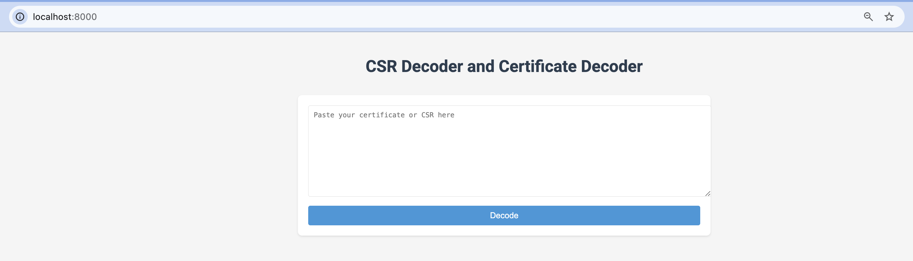

# CertDecoder

Decode CSR / Certificates directly in your browser - No server required!



## Description

A client-side certificate and CSR decoder that runs entirely in your browser:
- **100% Private** - Your certificates never leave your browser
- **No Backend Required** - Pure HTML/CSS/JavaScript
- **Free Hosting** - Can be hosted on GitLab Pages or any static site host
- Decodes X.509 certificates and Certificate Signing Requests (CSR)
- Calculates MD5 hash of certificates
- Download decoded output as text file
- Clean, modern UI

## Live Demo

Once deployed to GitLab Pages, your app will be available at:
```
https://<username>.gitlab.io/<project-name>/
```

## Quick Start - Local Testing

Simply open `index.html` in any modern web browser. That's it!

```bash
# Clone the repository
git clone <your-repo-url>
cd CertDecoder

# Open in browser
open index.html  # macOS
xdg-open index.html  # Linux
start index.html  # Windows
```

## Deploy to GitLab Pages

### Method 1: Using `.gitlab-ci.yml` (Recommended)

1. Create a `.gitlab-ci.yml` file in your repository root:

```yaml
pages:
  stage: deploy
  script:
    - mkdir .public
    - cp -r * .public
    - mv .public public
  artifacts:
    paths:
      - public
  only:
    - gitlab-pages  # or main, or whatever branch you want
```

2. Push to GitLab:

```bash
git add .
git commit -m "Add GitLab Pages deployment"
git push origin gitlab-pages
```

3. Go to your GitLab project → Settings → Pages
4. Your site will be live at `https://<username>.gitlab.io/<project-name>/`

### Method 2: Manual Upload

1. Go to your GitLab project
2. Navigate to Settings → Pages
3. Upload `index.html` and any other assets
4. Your site will be deployed automatically

## How It Works

### Client-Side Architecture

This application uses **node-forge**, a JavaScript implementation of TLS and cryptography tools:
- Parses X.509 certificates using `forge.pki.certificateFromPem()`
- Parses CSRs using `forge.pki.certificationRequestFromPem()`
- Calculates MD5 hashes using `forge.md.md5`
- All processing happens in your browser - no data is sent to any server

### Features

- **Certificate Decoding**: Extract all certificate details including:
  - Version, Serial Number
  - Issuer and Subject information
  - Validity period
  - Public key details
  - Extensions (SAN, Key Usage, etc.)
  - Signature information

- **CSR Decoding**: Extract CSR details including:
  - Subject information
  - Public key details
  - Attributes
  - Signature information

- **MD5 Hash**: Automatically calculated for verification
- **Download**: Save decoded output to your computer
- **Privacy**: All processing happens locally in your browser

## Usage

1. Open the application in your browser
2. Paste your certificate or CSR in PEM format:
   ```
   -----BEGIN CERTIFICATE-----
   MIIDXTCCAkWgAwIBAgIJAKL...
   -----END CERTIFICATE-----
   ```
3. Click "Decode"
4. View the decoded information
5. Optionally download the output as a text file

### Keyboard Shortcuts

- `Ctrl/Cmd + Enter` - Decode the certificate/CSR

## Requirements

- Any modern web browser (Chrome, Firefox, Safari, Edge)
- JavaScript enabled
- No server or Python installation needed

## Browser Compatibility

- ✅ Chrome/Edge (latest)
- ✅ Firefox (latest)
- ✅ Safari (latest)
- ✅ Opera (latest)

## Privacy & Security

This application runs entirely in your browser:
- ✅ No data is sent to any server
- ✅ No analytics or tracking
- ✅ No cookies or local storage
- ✅ Perfect for sensitive certificates
- ✅ Can run offline (after initial load)

## Differences from Python Version

The original Python version (`file.py` on `main` branch) used FastAPI and OpenSSL:
- Required a Python server to run
- Used OpenSSL command-line tools
- Saved files on the server

This version:
- Runs entirely in the browser
- Uses JavaScript cryptography (node-forge)
- Downloads files to your computer
- Can be hosted on free static site services

Both versions provide equivalent certificate decoding functionality.

## Dependencies

- [node-forge](https://github.com/digitalbazaar/forge) v1.3.1 (loaded from CDN)
- No npm install or build process required!

## Contributing

Contributions are welcome! This is a simple single-file application, so improvements are easy to make.

## License

Feel free to use and modify as needed.

## Troubleshooting

**Certificate not decoding?**
- Ensure it's in PEM format (text format with BEGIN/END markers)
- Check that the certificate is valid and not corrupted
- Try opening browser console (F12) to see any error messages

**Download not working?**
- Check your browser's download settings
- Ensure pop-ups are not blocked
- Try a different browser

## Original Python Version

The Python/FastAPI version is available on the `main` branch:
```bash
git checkout main
```

See the original README for Python setup instructions.
